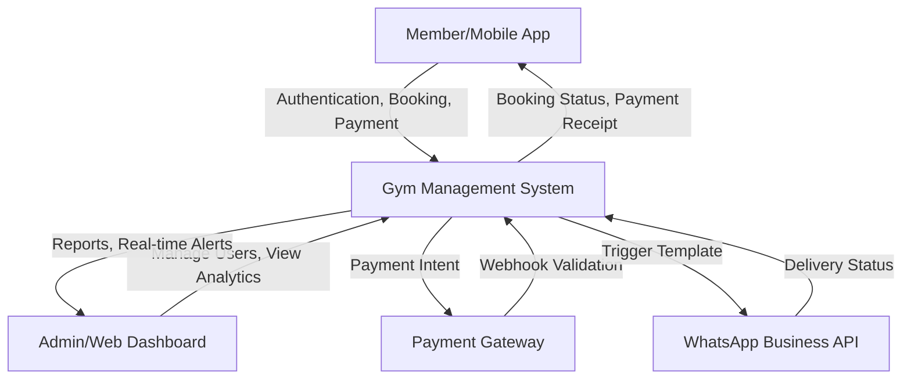
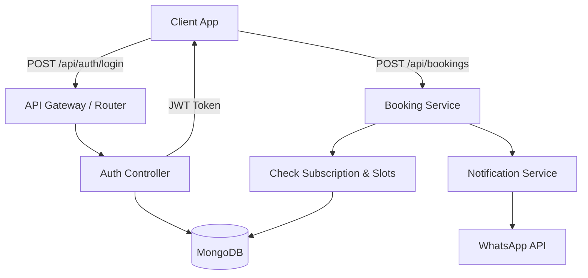

# 🏋️ Gym Management System: Comprehensive Technical Documentation

## 1. 📖 PROJECT OVERVIEW

### Problem Statement
Modern fitness centers struggle with fragmented operations—managing memberships, tracking attendance, scheduling personal training (PT) sessions, and handling payments across disparate platforms. This operational inefficiency leads to revenue leakage, poor member engagement, and high administrative overhead.

### Objective
To engineer a unified, omnichannel Gym Management platform consisting of a Web Dashboard (for admins/staff) and a Mobile Application (for members and staff). The system centralizes membership management, class bookings, payment processing, and automated user engagement (via WhatsApp).

### Target Users
* **Gym Owners/Administrators:** Full system access, financial analytics, user management, and broadcast messaging.
* **Trainers:** Schedule management, PT contract tracking, client progress monitoring.
* **Members:** Self-service class booking, subscription management, payment processing, and workout tracking.

### Real-world Use Case
A member registers via the mobile app, purchases a 6-month subscription using UPI, and books a "Group HIIT Class." The system automatically verifies the payment, updates their access status, sends a WhatsApp confirmation, and notifies the assigned trainer.

---

## 2. 🏗️ SYSTEM ARCHITECTURE

### High-level Architecture
The system employs a **Service-Oriented Architecture (SOA)**, leaning towards a modular monolith for backend operations, with distinct client interfaces.

* **Frontend (Web):** React.js + TailwindCSS (Admin & Staff Dashboard)
* **Frontend (Mobile):** React Native + Expo (Member & Trainer App)
* **Backend:** Node.js + Express.js
* **Database:** MongoDB (NoSQL) for flexible schema design (profiles, dynamic schedules).
* **External APIs:** Razorpay/Stripe (Payments), WhatsApp Business API (Notifications), Socket.io (Real-time updates).

### Microservices vs Monolith
Currently deployed as a **Modular Monolith** for reduced operational complexity and deployment speed. Components (Auth, Payments, Notifications) are logically separated within the Node.js process using Controller-Service-Repository patterns. This allows a seamless transition to Microservices (e.g., splitting out the Notification service or Payment service) when traffic dictates independent scaling.

### Tech Stack Justification
* **Node.js/Express:** Event-driven, non-blocking I/O is ideal for handling concurrent I/O heavy tasks like booking, socket connections, and real-time dashboard updates.
* **React/React Native:** Code reusability between web and mobile ecosystems; vast component ecosystem.
* **MongoDB:** Schema-less nature perfectly accommodates evolving workout plans, dynamic user attributes, and unstructured notification logs.

---

## 3. 🔄 DATA FLOW DIAGRAM (DFD)

### Level 0 Context Diagram

### Level 1 Detailed Flow (Core Operations)

* **Input Sources:** User actions (Mobile/Web), Payment Webhooks.
* **Processes:** Authentication, Slot Validation, Transaction Ledgering, Webhook processing.
* **Data Stores:** MongoDB Collections (Users, Memberships, Bookings, Transactions).
* **Outputs:** JSON API responses, Socket events (Web Dashboard), WhatsApp messages.

---

## 4. 🧩 COMPONENT DIAGRAM

### Modules and Responsibilities
1. **Authentication & Identity Module:** Manages JWT issuance, password resets, role-based access control (RBAC).
2. **Membership & PT Module:** Handles subscription tiers, validity tracking, and Personal Training contract mapping.
3. **Booking Engine:** Concurrency-safe slot management for group classes.
4. **Payment Service:** Interfaces with gateways, handles webhook signature validation, maintains transaction ledgers.
5. **Notification Hub:** Abstracts underlying communication channels (WhatsApp, Email, SMS).
6. **Admin Dashboard Service:** Aggregates analytics, handles Offer management, and syncs via WebSockets.

### Interaction
* Components interact via injected **Services** (e.g., `BookingController` calls `NotificationService` upon successful booking).
* **Events:** Decoupled operations (like sending emails after payment) use Node `EventEmitter` to avoid blocking the main thread.

---

## 5. 🔁 COMPLETE PIPELINES

### User Authentication Flow
1. **Login:** Client sends credentials `POST /api/auth/login`.
2. **Verification:** Backend decrypts hash via `bcrypt`, verifies against DB.
3. **Token Issuance:** Generates a short-lived Access Token (JWT) and a long-lived HTTP-only Refresh Token.
4. **Session:** Client attaches JWT in `Authorization: Bearer <token>` header for subsequent requests.

### Payment Flow (UPI/Card integration)
1. **Initiation:** Client selects plan. Backend generates an Order ID (`POST /api/payments/order`).
2. **Checkout:** Client completes transaction on the Gateway UI.
3. **Verification (Critical):** Gateway triggers a Backend Webhook (`POST /api/payments/webhook`). Backend verifies HMAC signature.
4. **Fulfillment:** Backend updates User's `membershipExpiry`, logs transaction, and triggers WhatsApp confirmation.

### Notification System (WhatsApp)
1. **Trigger:** Event (e.g., `membership_expiring`) fired by a daily CRON job.
2. **Queueing:** Message payload sent to `whatsappService.js`.
3. **Dispatch:** Service constructs payload using pre-approved WhatsApp Business templates.
4. **Delivery:** API call to Meta Graph API. Delivery status logged to DB.

### Admin Dashboard Workflow
1. **Real-time Sync:** Admin logs in, opens WebSocket connection (`Socket.io`).
2. **Event Listening:** When a mobile user makes a payment, the backend emits an `update_dashboard` event.
3. **Re-render:** React state updates instantly without page refresh, updating revenue counters.

---

## 6. 🗄️ DATABASE DESIGN

### Entity-Relationship Diagram (Text)
* **User** (1) ---- (N) **Subscription**
* **User** (1) ---- (N) **Booking**
* **ClassSchedule** (1) ---- (N) **Booking**
* **User (Trainer)** (1) ---- (N) **PTContract** (N) ---- (1) **User (Member)**

### Tables/Collections
* `Users`: `_id`, `name`, `phone`, `role` (admin, staff, member, trainer), `passwordHash`, `status`.
* `Subscriptions`: `_id`, `userId`, `planId`, `startDate`, `endDate`, `paymentStatus`.
* `Bookings`: `_id`, `userId`, `classId`, `status` (booked, cancelled, attended), `timestamp`.
* `Transactions`: `_id`, `userId`, `amount`, `gatewayOrderId`, `signature`, `status`.

### Normalization Strategy
Given MongoDB (NoSQL), we use **hybrid normalization**. 
* **Normalized:** User credentials and core profile data.
* **Denormalized:** We embed `planName` and `amount` directly inside the `Subscription` document to prevent expensive lookups and preserve historical data (if plan prices change).

---

## 7. ⚙️ BACKEND DESIGN

### API Structure (REST)
Following RESTful conventions with resource-based routing.
* `GET /api/v1/users/me` (Profile)
* `POST /api/v1/bookings` (Create booking)
* `PATCH /api/v1/admin/offers/:id` (Update offer)

### Middleware Stack
1. **`requestLogger`:** Morgan for logging API hits.
2. **`authMiddleware`:** Verifies JWT and injects `req.user`.
3. **`roleGuard(['admin', 'staff'])`:** RBAC validation.
4. **`validateSchema(joiSchema)`:** Joi/Zod schema validation before hitting controllers.

### Error Handling Strategy
* Centralized `errorHandler` middleware catches all `next(err)` calls.
* Maps custom error classes (`AppError`) to HTTP status codes.
* Avoids leaking stack traces in production.

---

## 8. 🎨 FRONTEND ARCHITECTURE

### Web & Mobile Component Structure
* **Atomic Design:** `atoms` (Buttons, Inputs), `molecules` (Form Fields), `organisms` (TopBar, Sidebar), `pages` (Register, Dashboard).

### State Management
* **Global State:** React Context API for `AuthContext` (managing user session and RBAC).
* **Server State:** React Query / SWR or standard Axios with local state for fetching and caching API data. Reduces prop drilling and handles loading/error states seamlessly.

### API Integration Flow
* Centralized `api.js` Axios instance.
* Interceptors automatically attach JWTs and handle `401 Unauthorized` by attempting a refresh token rotation or logging the user out.

### Responsive Design
* Web: Tailwind CSS grid/flexbox layouts.
* Mobile: React Native Flexbox, dynamic sizing based on `Dimensions.get('window')`.

---

## 9. 🤖 AI/ML INTEGRATION (CONCEPTUAL/FUTURE)

### Predictive Churn Analysis
* **Model:** Random Forest / XGBoost classifier.
* **Data Input:** Member attendance frequency, time spent per session, payment delays, interaction with app.
* **Data Output:** Churn Probability Score (0.0 to 1.0).
* **Real-world Benefit:** If a user scores > 0.7, the system automatically triggers a targeted WhatsApp discount offer to re-engage them before they cancel.

---

## 10. 🔐 SECURITY DESIGN

### Authentication & Authorization
* Passwords hashed via `bcrypt` (salt rounds = 10).
* JWTs are short-lived.
* Strict Role-Based Access Control (RBAC) enforced at the API route level.

### Data Protection & Vulnerabilities
* **CORS:** Strictly configured to accept requests only from recognized frontend origins.
* **Rate Limiting:** IP-based rate limiting on `/api/auth/login` to prevent brute-force attacks.
* **NoSQL Injection:** Mongoose ODM inherently sanitizes inputs, preventing standard injection attacks.

### Payment Security
* PCI-DSS compliance is outsourced entirely to the payment gateway.
* Critical backend logic relies **only** on Cryptographic Webhook verification, ignoring client-side payment success messages to prevent tampering.

---

## 11. 🚀 DEPLOYMENT ARCHITECTURE

### Hosting Infrastructure
* **Frontend Web:** Vercel (Global Edge CDN, auto-scaling).
* **Backend:** AWS EC2 / DigitalOcean Droplet managed via PM2 (Process Manager).
* **Database:** MongoDB Atlas (managed DBaaS with automated backups and replica sets).

### CI/CD Pipeline
* **GitHub Actions:** 
  * On `push` to `main`: Run ESLint, Jest unit tests.
  * If tests pass: Trigger Vercel build for frontend. SSH into production server, `git pull`, `npm install`, and `pm2 restart api` for backend.

---

## 12. 📈 SCALABILITY & PERFORMANCE

### Load Handling
* **Node.js Clustering:** PM2 configured to run in cluster mode, spawning a worker process for every CPU core.
* **Horizontal Scaling:** API is stateless (sessions in JWT), meaning a Load Balancer (Nginx/AWS ALB) can distribute traffic across multiple Node.js instances.

### Caching Strategy
* **Redis Integration:** Caching static catalog data (Gym Plans, Active Offers) to reduce MongoDB load.
* Invalidation: Cache cleared only when Admin updates plans.

---

## 13. 🧪 TESTING STRATEGY

* **Unit Testing (Jest):** Testing utility functions, JWT generation, and discount calculations in isolation.
* **Integration Testing (Supertest):** Hitting API endpoints with mock DB to ensure route-controller-DB flow works (e.g., creating a user and attempting login).
* **Edge Cases:** Testing concurrent bookings for a single slot, handling invalid webhook signatures.

---

## 14. ⚠️ CHALLENGES & SOLUTIONS

### Challenge 1: Local Network Mobile Connectivity
* **Problem:** React Native app dropping "Network Error" when connecting to localhost backend.
* **Solution:** Configured dynamic IP binding in `api.js` (e.g., `172.16.x.x`) and ensured Windows Defender Firewall allowed inbound connections on port 5000.

### Challenge 2: Synchronizing Mobile Admin & Web Dashboard
* **Problem:** Changes made in the mobile admin panel (like Offer deletion) didn't reflect on the web dashboard immediately.
* **Solution:** Implemented `Socket.io`. Mobile triggers API, API updates DB and emits `offer_updated` event to all connected web clients, ensuring real-time parity.

---

## 15. 🔮 FUTURE IMPROVEMENTS

* **Microservices Transition:** Extracting WhatsApp/Notification logic into a separate worker service managed by RabbitMQ or Redis Bull queue to prevent API blocking during high broadcast volumes.
* **Hardware Integration:** Integrating RFID/Biometric turnstiles directly with the backend to automate attendance logging without mobile app scanning.
* **Advanced Analytics:** Implementing a dedicated OLAP database (like ClickHouse) for complex revenue reporting and cohort analysis.
